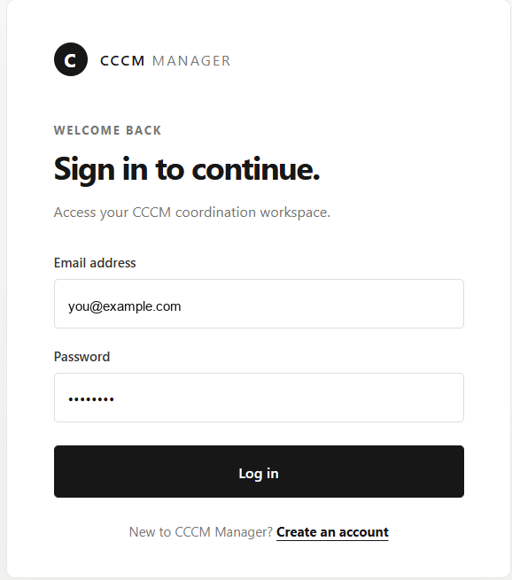
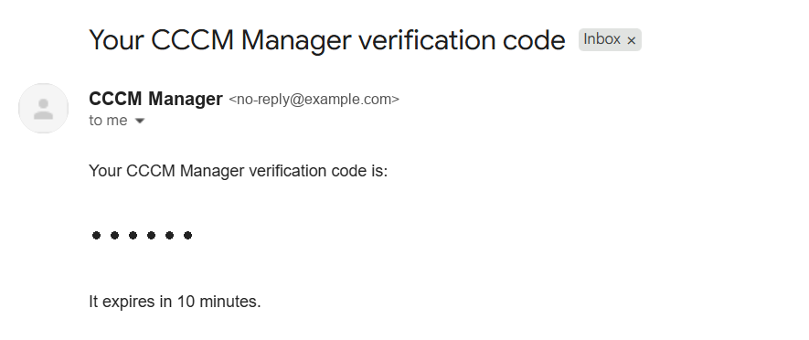
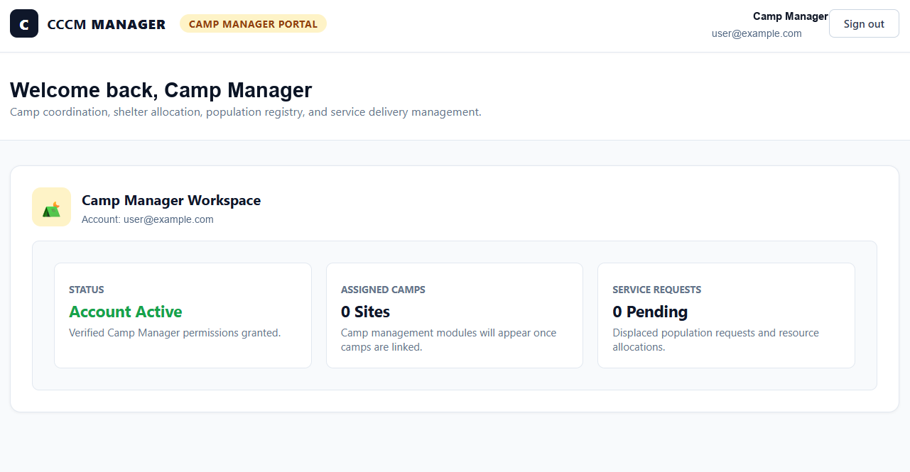
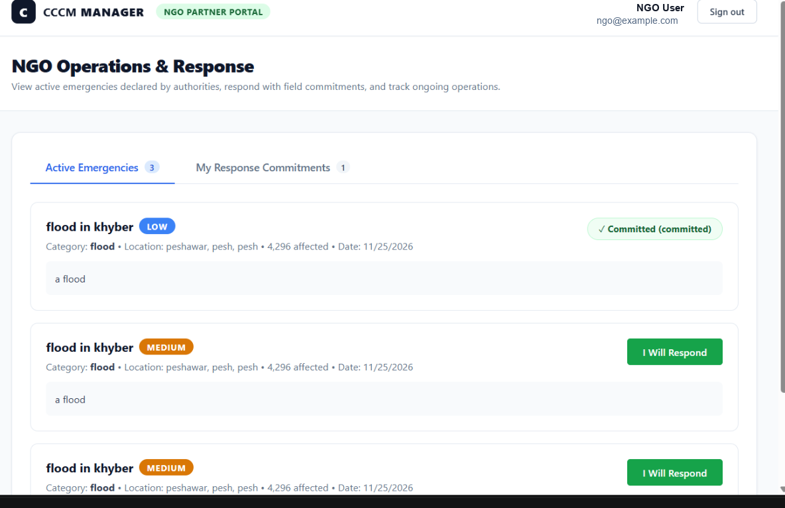
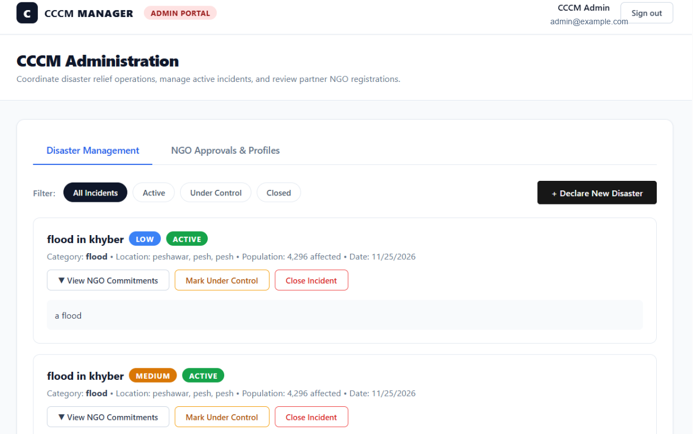

# CCCM Manager

CCCM Manager is a full-stack project with a React client and a Node.js/Express backend using MongoDB and Mongoose.

## Backend progress

- Added Mongoose schemas for users, camps, camp-NGO relationships, disasters, disaster commitments, email verification codes, NGOs, notifications, requests, shortage offers, and site assessments.
- Added the MongoDB connection helper in `server/src/config/db.js`.
- Installed the backend dependencies listed in `server/package.json`, including Mongoose, dotenv, bcryptjs, jsonwebtoken, and nodemailer.
- Added `server/src/scripts/testModels.js` to check model defaults, validation, indexes, and relationships.
- Added `.gitignore` rules for environment files and `node_modules`.

## MongoDB connection status

The MongoDB connection was confirmed with Mongoose. MongoDB Compass also showed the test database `cccm_manager_test_1793734713538` and its model collections, including users, camps, disasters, NGOs, requests, notifications, and site assessments.

Keep the MongoDB URI in `server/.env` as `MONGO_URI=...`. Do not commit `.env` files.

## Run the model checks

From the `server` directory:

```powershell
node src/scripts/testModels.js
```

The script creates a uniquely named test database and leaves it in MongoDB for inspection. It does not drop the database. The last recorded run connected successfully and passed 9 checks; 3 request-related checks still need fixes (`next is not a function` in request checks and a failed populate lookup).

## Account creation and email verification

The sign-up flow creates an account in a pending, unverified state and sends a six-digit verification code by email. The code expires after 10 minutes. After verification, users can sign in; NGO accounts also require administrator approval before access.

### Sign-in



### Email verification message

The screenshot uses placeholder contact details and a masked verification code.



## Portal previews

Initial portal screens have been created for camp managers, NGO partners, and administrators. These portals are starting points for the role-based workflows; some features are still in development and will be added in future updates.

### Camp manager portal



### NGO partner portal



### Admin portal


